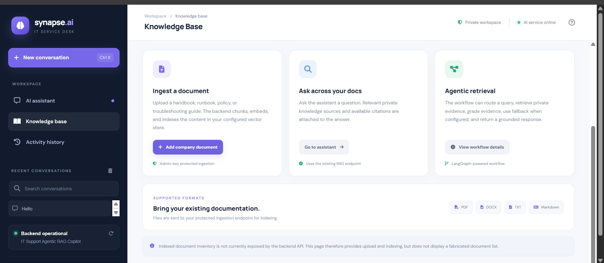
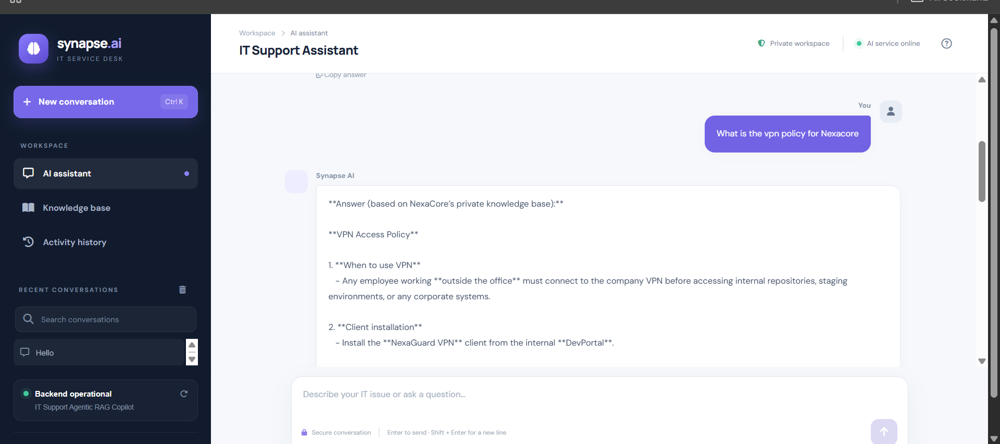
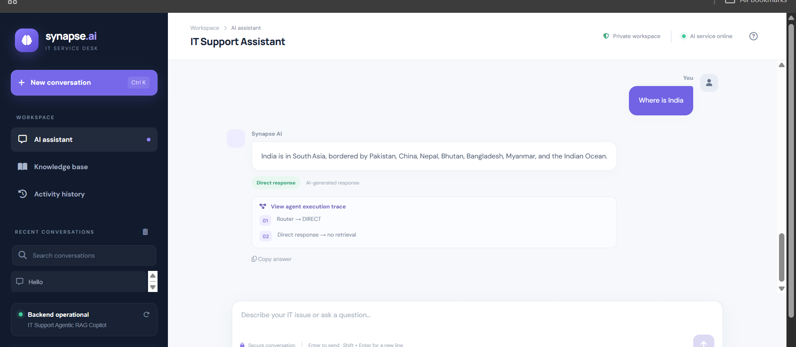
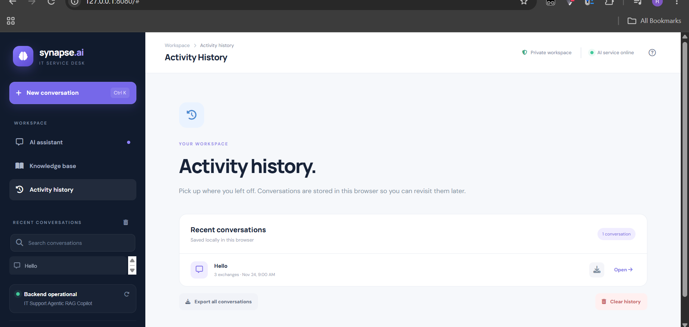
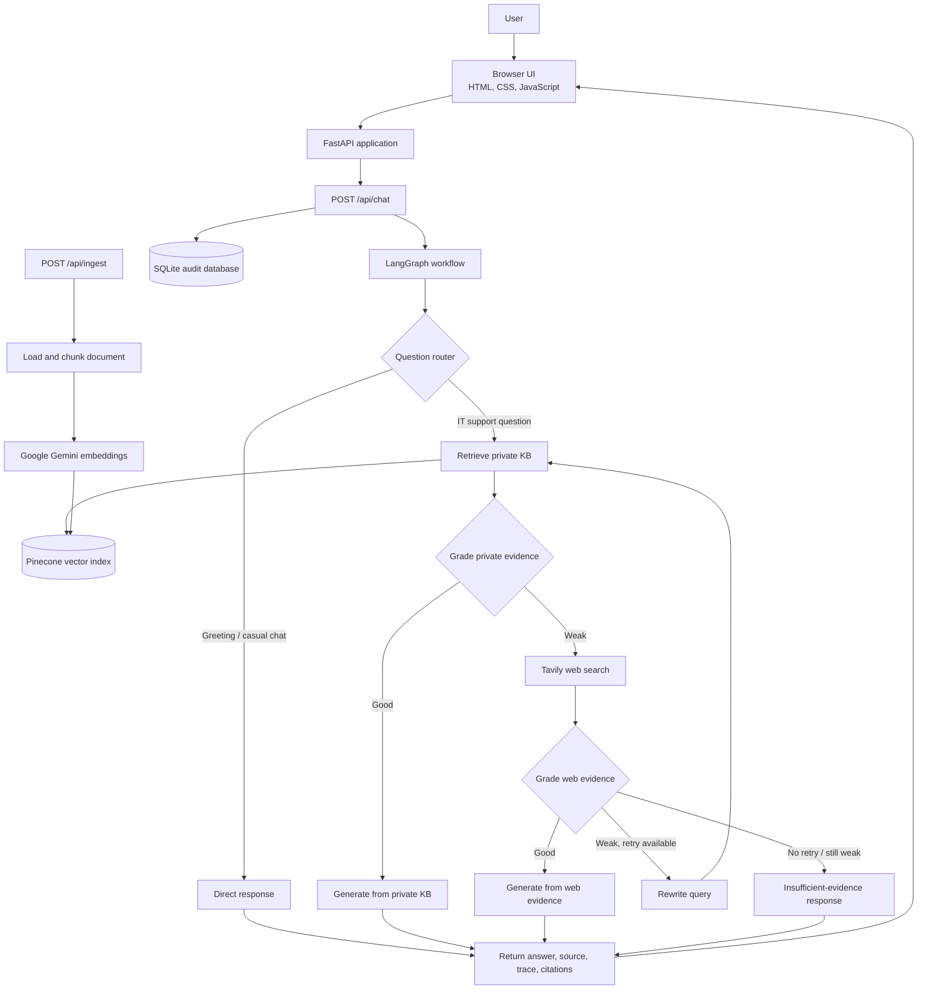

# Agentic IT Support Copilot

An agentic, retrieval-augmented IT support assistant that answers employee technology questions using an organisation's private documentation first, evaluates whether the retrieved evidence is sufficient, and falls back to external web search when the private knowledge base cannot confidently answer. The application is built with **FastAPI, LangGraph, LangChain, Pinecone, Google Gemini embeddings, Groq, and Tavily**, with a responsive browser-based workspace.

> **Project status:** Local application. The core chat, document-ingestion, private retrieval, web-fallback, and frontend workflows have been tested locally. A public deployment is not currently available.

---

## Contents

- [Overview](#overview)
- [Why this project](#why-this-project)
- [Features](#features)
- [Application screenshots](#application-screenshots)
- [Architecture](#architecture)
- [Agent workflow](#agent-workflow)
- [RAG and document ingestion](#rag-and-document-ingestion)
- [Technology stack](#technology-stack)
- [Repository structure](#repository-structure)
- [Prerequisites](#prerequisites)
- [Configuration](#configuration)
- [Installation and setup](#installation-and-setup)
  - [1. Clone the repository](#1-clone-the-repository)
  - [2. Create and activate a virtual environment](#2-create-and-activate-a-virtual-environment)
  - [3. Install dependencies](#3-install-dependencies)
  - [4. Configure environment variables](#4-configure-environment-variables)
  - [5. Start the application](#5-start-the-application)
  - [6. Index the sample knowledge base](#6-index-the-sample-knowledge-base)
- [Using the application](#using-the-application)
- [API reference](#api-reference)
- [Execution trace and source attribution](#execution-trace-and-source-attribution)
- [Data storage](#data-storage)
- [Security notes](#security-notes)
- [Troubleshooting](#troubleshooting)
- [Current limitations](#current-limitations)
- [Potential future improvements](#potential-future-improvements)
- [Author](#author)

---

## Overview

IT support teams repeatedly answer questions about VPN access, password resets, multi-factor authentication, device configuration, email, software permissions, and internal troubleshooting procedures. The information needed to resolve these issues is often spread across handbooks, policies, and runbooks.

The **Agentic IT Support Copilot** provides a conversational interface over that documentation. Rather than sending every question directly to a language model, it uses a stateful LangGraph workflow to decide how a question should be handled:

1. Route casual conversation directly to a response path.
2. Route IT-support questions through private knowledge-base retrieval.
3. Grade the retrieved private evidence before generating an answer.
4. Use web search if the private evidence is weak.
5. Grade external evidence and, if necessary, rewrite the query and retry within the configured retry limit.
6. Return a grounded answer or an explicit insufficient-evidence response.

The goal is to make answers more useful and traceable while reducing unsupported claims about organisation-specific policies.

## Why this project

A general-purpose chatbot may produce plausible answers that do not reflect an organisation's actual IT policies. For example, VPN setup instructions, password requirements, or software-access procedures can differ from one company to another.

This project addresses that gap by prioritising organisation-provided documentation and checking whether retrieved evidence is adequate before using it. External web information is treated as a fallback and is labelled as such in the generated answer.

## Features

### Agentic question routing

- Uses an LLM-backed structured routing decision to distinguish IT-support questions from greetings and casual conversation.
- Sends support questions through the knowledge retrieval workflow.
- Avoids unnecessary retrieval for simple direct-response messages.

### Retrieval-augmented generation

- Embeds document chunks using Google Gemini embeddings.
- Stores and retrieves vectors from Pinecone.
- Retrieves the configured top-*k* chunks for a query.
- Grades retrieved private evidence before using it to generate an answer.
- Instructs the private-knowledge answer path to use only the supplied company knowledge-base context.

### Evidence-aware web fallback

- Calls Tavily when private knowledge-base evidence is graded as weak.
- Grades web evidence before generating an external-information answer.
- Rewrites the original query and retries the retrieval/search path when web evidence remains weak and retries are available.
- Returns a clear insufficient-evidence response if the workflow cannot establish a sufficiently reliable basis for an answer.

### Document ingestion

- Supports **PDF, DOCX, TXT, and Markdown (`.md`)** files.
- Extracts text, splits it into overlapping chunks, creates embeddings, and indexes the chunks in Pinecone.
- Protects the upload endpoint with an admin-key header.
- Includes sample IT documentation under `data/sample_kb/` and a script to index it.

### Traceable responses

- Returns the source category used by the workflow.
- Returns a step-by-step execution trace from the LangGraph workflow.
- Returns private knowledge-base source labels or external web citations when available.
- Records the question, source category, timestamp, and execution trace in SQLite.

### Browser workspace

- Responsive assistant interface with suggested starter questions.
- New conversations and locally saved conversation history.
- Search, reopen, export, and clear conversation-history actions.
- Knowledge-base page with document upload.
- Activity-history page.
- Backend health indicator and workflow-trace display.

**Conversation-history note:** conversation history is stored in the browser's `localStorage`; it is not synchronised to the server. The SQLite audit database is separate and stores query audit records, not full chat transcripts.

## Application screenshots

The screenshots below show the local application interface.

### AI assistant — direct response



### AI assistant — private knowledge-base response



### Knowledge base and document ingestion



### Activity history



---

## Architecture



### Main components

| Component | Responsibility |
|---|---|
| Browser frontend | Collects questions, displays answers and traces, manages browser-local conversations, and uploads documents. |
| FastAPI | Serves the frontend and exposes chat, ingestion, and health endpoints. |
| LangGraph | Coordinates routing, retrieval, evidence grading, fallback, query rewriting, and response generation. |
| Groq-hosted chat model | Performs routing, evidence grading, query rewriting, and natural-language response generation. |
| Google Gemini embeddings | Converts document chunks and search queries into vector representations. |
| Pinecone | Stores and retrieves embedded knowledge-base chunks. |
| Tavily | Supplies external search evidence when private evidence is insufficient. |
| SQLite | Persists query audit records and execution traces. |

## Agent workflow

The graph is defined in `app/rag/workflow.py`, and its shared state and structured output models are defined in `app/rag/state.py`.

### 1. Route the question

The router uses a structured LLM output with two possible route labels:

- `kb`: company IT policies, VPN, password reset, MFA, laptop setup, software access, security, email, devices, troubleshooting, and technology support.
- `direct`: greetings, thanks, and casual messages that do not require company knowledge.

### 2. Retrieve private knowledge

For the `kb` route, the workflow queries the Pinecone-backed retriever using the current query. The retriever requests `TOP_K` chunks (default: `4`).

### 3. Grade private evidence

A second structured LLM decision grades the retrieved context as `good` or `weak`. The workflow only generates a private-knowledge answer when the evidence is judged sufficient to answer confidently and specifically.

### 4. Fall back to web search

If private evidence is weak, the workflow calls Tavily. The current implementation requests up to five general web results and includes Tavily's answer when available.

### 5. Grade web evidence and optionally rewrite

The workflow grades the web evidence. If it is good, the assistant generates an answer based only on that external evidence and warns that it may need IT validation before changing company-managed systems. If it is weak and the retry limit has not been reached, the workflow rewrites the query and returns to private retrieval. The retry limit is controlled by `MAX_RETRIES` (default: `1`).

### 6. Return an answer or stop safely

The graph can finish through one of four response paths:

- Direct response.
- Answer generated from private knowledge-base evidence.
- Answer generated from web evidence.
- Insufficient-evidence response.

The API returns the answer together with source information, citations, and the trace collected during graph execution.

## RAG and document ingestion

### Supported file formats

| Format | Loader used |
|---|---|
| PDF | `PyPDFLoader` |
| DOCX | `python-docx` |
| TXT | `TextLoader` with UTF-8 encoding |
| Markdown | `TextLoader` with UTF-8 encoding |

### Chunking configuration

The ingestion service uses `RecursiveCharacterTextSplitter` with the following settings:

| Setting | Value |
|---|---:|
| Chunk size | 900 characters |
| Chunk overlap | 120 characters |
| Start index metadata | Enabled |

Each chunk retains its document metadata, including its source, and is added to the configured Pinecone namespace.

### Embedding and vector storage

The default embedding model is `gemini-embedding-001`. The vector-store implementation configures the Pinecone index for cosine similarity and uses a 3072-dimensional embedding size for the configured Gemini embedding model. The namespace defaults to `company-it-kb`.

> **Important:** review `app/rag/vectorstore.py` before pointing this application at an existing or production Pinecone index. The current `ensure_index()` implementation deletes and recreates the configured index if its detected dimension differs from the expected embedding dimension. That operation can remove existing vectors in that index.

## Technology stack

| Layer | Technology | Usage |
|---|---|---|
| Backend framework | FastAPI | HTTP API and application serving |
| ASGI server | Uvicorn | Runs the FastAPI application |
| Agent orchestration | LangGraph | Stateful graph and conditional workflow routing |
| LLM integration | LangChain + `ChatGroq` | Structured routing/grading and answer generation |
| Chat model provider | Groq | Hosts the configured chat model |
| Embeddings | Google Gemini | Document and query embeddings |
| Vector database | Pinecone | Similarity search over indexed chunks |
| Web search | Tavily | External evidence fallback |
| Document processing | LangChain loaders, pypdf, python-docx | Text extraction and chunk preparation |
| Audit storage | SQLite | Query audit records and graph traces |
| Frontend | HTML, CSS, JavaScript | Responsive user interface |
| Configuration | pydantic-settings, python-dotenv | Environment-based configuration |

## Repository structure

```text
Agentic-IT-support-copilot/
│
├── app/
│   ├── api/
│   │   └── routes.py              # Health, chat, and document-ingestion endpoints
│   ├── core/
│   │   ├── config.py              # Application settings and environment variables
│   │   └── logging.py             # Logging configuration
│   ├── rag/
│   │   ├── state.py               # LangGraph state and structured output models
│   │   ├── vectorstore.py         # Gemini embeddings and Pinecone integration
│   │   └── workflow.py            # Agent graph and RAG workflow nodes
│   ├── services/
│   │   ├── audit.py               # SQLite audit persistence
│   │   └── ingestion.py           # File loading and text chunking
│   └── main.py                    # FastAPI app and frontend mounting
│
├── data/
│   └── sample_kb/
│       ├── IT_handbook.md         # Sample IT knowledge-base document
│       └── service_desk_runbook.md# Sample service-desk runbook
│
├── docs/
│   └── screenshots/               # README screenshots
│
├── static/
│   ├── CSS/
│   │   └── style.css              # Frontend styles
│   └── js/
│       └── app.js                 # Frontend interactions and API calls
│
├── templates/
│   └── index.html                 # Main application page
│
├── .env                           # Local secrets (create this; do not commit)
├── .gitignore
├── create_project.py
├── ingest_sample_kb.py             # Indexes all files in data/sample_kb/
├── requirements.txt
├── run.py                          # Local development entry point
└── README.md
```

## Prerequisites

Before running the project, prepare:

- Python (Python 3.11 is a suitable environment for this dependency set).
- A [Groq API key](https://console.groq.com/).
- A [Google AI Studio API key](https://aistudio.google.com/app/apikey) for Gemini embeddings.
- A [Pinecone API key](https://app.pinecone.io/).
- A [Tavily API key](https://tavily.com/) for the web-fallback path.
- Git and a terminal.

The application can start without calling every external service, but the corresponding feature will fail when its required key is missing. In particular, IT-question retrieval requires Google embeddings and Pinecone; the LLM workflow requires Groq; and fallback search requires Tavily.

## Configuration

Create a file named `.env` in the repository root. Use the following template:

```dotenv
# Application
APP_NAME=IT Support Agentic RAG Copilot
APP_ENV=development

# Model providers
GROQ_API_KEY=your_groq_api_key
GOOGLE_API_KEY=your_google_ai_studio_api_key
TAVILY_API_KEY=your_tavily_api_key

# Pinecone
PINECONE_API_KEY=your_pinecone_api_key
PINECONE_INDEX_NAME=it-support-rag
PINECONE_NAMESPACE=company-it-kb

# Model and retrieval settings
GROQ_MODEL=openai/gpt-oss-120b
EMBEDDING_MODEL=gemini-embedding-001
TOP_K=4
MAX_RETRIES=1

# Ingestion protection — replace this value with a strong secret
ADMIN_API_KEY=replace_with_a_long_random_secret

# Local storage paths (optional)
AUDIT_DB_PATH=data/audit.db
UPLOAD_DIR=uploads
SAMPLE_KB_DIR=data/sample_kb
```

### Environment variable reference

| Variable | Default in application | Description |
|---|---|---|
| `APP_NAME` | `IT Support Agentic RAG Copilot` | Service name returned by health checks. |
| `APP_ENV` | `development` | Environment label. |
| `GROQ_API_KEY` | Empty | Required for the Groq chat model. |
| `GOOGLE_API_KEY` | Empty | Required for Google Gemini embeddings. |
| `TAVILY_API_KEY` | Empty | Required when the workflow invokes web fallback. |
| `PINECONE_API_KEY` | Empty | Required for vector-index access. |
| `PINECONE_INDEX_NAME` | `it-support-rag` | Pinecone index name. |
| `PINECONE_NAMESPACE` | `company-it-kb` | Namespace used by the vector store. |
| `GROQ_MODEL` | `openai/gpt-oss-120b` | Chat model identifier passed to `ChatGroq`. |
| `EMBEDDING_MODEL` | `gemini-embedding-001` | Google embedding model identifier. |
| `TOP_K` | `4` | Number of chunks requested by the retriever. |
| `MAX_RETRIES` | `1` | Maximum query-rewrite retry count after weak web evidence. |
| `ADMIN_API_KEY` | `change-me` | Secret expected in the ingestion request header. |
| `AUDIT_DB_PATH` | `<repo>/data/audit.db` | SQLite audit database path. |
| `UPLOAD_DIR` | `<repo>/uploads` | Destination for uploaded documents. |
| `SAMPLE_KB_DIR` | `<repo>/data/sample_kb` | Directory read by the sample-ingestion script. |

**Keep credentials private.** Do not commit `.env`, API keys, database files containing real user activity, or confidential company documents to a public repository.

## Installation and setup

The commands below are provided for Windows PowerShell and macOS/Linux shells.

### 1. Clone the repository

```bash
git clone https://github.com/Rishabh-0909/Agentic-IT-support-copilot.git
cd Agentic-IT-support-copilot
```

If your GitHub repository uses a different name or URL, replace the clone URL accordingly.

### 2. Create and activate a virtual environment

**Windows PowerShell:**

```powershell
py -3.11 -m venv .venv
.\.venv\Scripts\Activate.ps1
```

If PowerShell blocks activation, you can activate the environment for the current terminal session with:

```powershell
Set-ExecutionPolicy -Scope Process -ExecutionPolicy Bypass
.\.venv\Scripts\Activate.ps1
```

**macOS / Linux:**

```bash
python3.11 -m venv .venv
source .venv/bin/activate
```

### 3. Install dependencies

Upgrade pip and install the pinned project requirements:

```bash
python -m pip install --upgrade pip
pip install -r requirements.txt
```

### 4. Configure environment variables

Create `.env` in the repository root and fill in the API keys using the [configuration template](#configuration). Replace the default admin key before exposing the application beyond your own machine.

### 5. Start the application

```bash
python run.py
```

The development server starts at:

- Application: <http://127.0.0.1:8080>
- Health endpoint: <http://127.0.0.1:8080/health>
- API health endpoint: <http://127.0.0.1:8080/api/health>

Open the application URL in your browser. The `run.py` entry point enables Uvicorn reload mode for local development.

### 6. Index the sample knowledge base

In a **second terminal**, activate the same virtual environment, ensure the `.env` file contains valid Google and Pinecone credentials, and run:

```bash
python ingest_sample_kb.py
```

The script reads all files in `data/sample_kb/`, loads and chunks them, and adds the chunks to the configured Pinecone namespace. It prints the number of source files, chunks, and vector IDs created.

After indexing, ask a question that is covered by the sample handbook or runbook. For example:

- `What is the VPN access policy?`
- `How should an employee contact the service desk?`

The answer depends on the content currently present in your own indexed knowledge base. The sample documents are demonstration data, not universal company policies.

---

## Using the application

### AI assistant

1. Open the application in your browser.
2. Start a new conversation or choose a suggested question.
3. Enter an IT-support question in the message composer.
4. Review the answer and its source label.
5. Expand the agent execution trace to see which workflow steps ran.
6. Review any available citations.

### Add a company document

1. Open **Knowledge base** in the sidebar.
2. Choose **Add company document**.
3. Select a PDF, DOCX, TXT, or Markdown file.
4. Enter the configured admin key when prompted.
5. Submit the document and wait for the indexing result.

The upload endpoint extracts text, chunks it, and indexes the chunks in Pinecone. The current backend does not expose an endpoint for listing or deleting indexed documents, so the UI does not claim to provide a complete document inventory.

### Conversation history

The frontend stores conversation history in the current browser's `localStorage`. It can be searched, reopened, exported, or cleared from the workspace. Clearing browser history does not delete SQLite audit records or Pinecone vectors.

## API reference

The FastAPI application exposes the following endpoints.

### `GET /api/health`

Returns the API service status.

**Example response:**

```json
{
  "status": "ok",
  "service": "IT Support Agentic RAG Copilot"
}
```

### `GET /health`

Returns the application-level health response.

**Example response:**

```json
{
  "status": "healthy",
  "service": "IT Support Agentic RAG Copilot"
}
```

### `POST /api/chat`

Runs the LangGraph assistant workflow for a question.

**Request body:**

```json
{
  "question": "What is the VPN access policy?"
}
```

Validation: `question` must contain between 2 and 3000 characters.

**Example response shape:**

```json
{
  "answer": "The generated answer appears here.",
  "source_used": "private_kb",
  "trace": [
    "Router → KB",
    "Private KB retrieval → 4 chunks",
    "KB evidence grade → GOOD",
    "Answer generation → PRIVATE KB"
  ],
  "citations": [
    {
      "title": "IT_handbook.md",
      "url": "",
      "type": "private_kb"
    }
  ],
  "rewritten_query": "What is the VPN access policy?"
}
```

The example illustrates the response structure; actual answers, trace entries, and citation counts depend on the question and retrieved content. The `source_used` value can identify a direct response, private knowledge-base response, web-search response, or insufficient-evidence outcome.

**cURL example:**

```bash
curl -X POST "http://127.0.0.1:8080/api/chat" \
  -H "Content-Type: application/json" \
  -d '{"question":"What is the VPN access policy?"}'
```

**PowerShell example:**

```powershell
$body = @{ question = "What is the VPN access policy?" } | ConvertTo-Json
Invoke-RestMethod -Uri "http://127.0.0.1:8080/api/chat" -Method Post -ContentType "application/json" -Body $body
```

### `POST /api/ingest`

Uploads and indexes a knowledge-base document. This endpoint requires the admin key in the `X-Admin-Key` header.

**Request:** `multipart/form-data`

| Field | Type | Description |
|---|---|---|
| `file` | File | PDF, DOCX, TXT, or Markdown document. |
| `X-Admin-Key` | Header | Must match `ADMIN_API_KEY`. |

**cURL example:**

```bash
curl -X POST "http://127.0.0.1:8080/api/ingest" \
  -H "X-Admin-Key: replace_with_your_admin_key" \
  -F "file=@./path/to/IT_handbook.pdf"
```

**Example success response:**

```json
{
  "message": "Document indexed",
  "file": "IT_handbook.pdf",
  "chunks": 12,
  "ids_created": ["vector-id-1", "vector-id-2"]
}
```

The number of chunks and generated vector IDs depend on the uploaded document.

**Relevant error responses:**

- `401`: invalid admin key.
- `400`: unsupported file extension.
- `422`: request validation or missing multipart file.
- `500`: an unexpected processing, provider, or storage error.

## Execution trace and source attribution

The frontend displays the trace returned by the backend. Example trace steps can include:

- `Router → KB`
- `Private KB retrieval → N chunks`
- `KB evidence grade → GOOD` or `WEAK`
- `Web fallback → Tavily search`
- `Web evidence grade → GOOD` or `WEAK`
- `Query rewrite → ...`
- `Answer generation → PRIVATE KB` or `WEB SEARCH`
- `Direct response → no retrieval`
- `Stopped → insufficient reliable evidence`

Private knowledge-base citations identify the source document name, but do not expose a public URL. Tavily citations include external result titles and URLs when supplied by the search response. A trace is useful for understanding the path taken; it is not a formal guarantee that every model judgement is correct.

## Data storage

| Data | Storage location | Notes |
|---|---|---|
| Vector embeddings and document chunks | Pinecone | Stored in the configured index and namespace. |
| Uploaded source files | `uploads/` by default | The directory is created when a document is uploaded. |
| Query audit entries | SQLite database at `data/audit.db` by default | Stores timestamp, question, source category, and serialized trace. |
| Browser conversation history | Browser `localStorage` | Local to the browser profile and origin; not server-side history. |

The audit database is initialised automatically when a chat request is logged. Keep in mind that the audit table stores the user's question, so do not send confidential information unless your data-handling requirements permit it.

## Security notes

This is a local project/demo implementation and should be hardened before production use.

- Keep provider keys and the admin key in `.env`; never commit secrets.
- Replace the default `ADMIN_API_KEY=change-me` with a strong random value.
- Restrict access to the ingestion endpoint. The current implementation uses a shared admin-key header, not a full user identity and role-management system.
- Use HTTPS, authentication, authorisation, rate limiting, request-size limits, and secure secret management before deployment.
- Validate and scan uploaded documents if accepting files from untrusted users.
- Treat retrieved documents and external web pages as untrusted input; review prompt-injection and data-exfiltration risks before using this system with sensitive internal content.
- Apply appropriate retention and access controls to uploaded documents, browser history, audit records, and vector data.
- Do not expose a Pinecone index or provider credentials in client-side code.
- Review the index-dimension mismatch behaviour described in [RAG and document ingestion](#rag-and-document-ingestion) before using an existing Pinecone index.

## Troubleshooting

| Problem | Likely cause | What to check |
|---|---|---|
| `GROQ_API_KEY is missing` | Groq key is absent or not loaded. | Check the root `.env` spelling and restart the server after editing it. |
| `GOOGLE_API_KEY is missing` | Google API key is absent. | Set `GOOGLE_API_KEY`; it is needed to create embeddings. |
| `TAVILY_API_KEY is missing` | The workflow reached web fallback without a Tavily key. | Set `TAVILY_API_KEY` and restart the app. |
| `PINECONE_API_KEY is missing` | Pinecone key is absent. | Set `PINECONE_API_KEY` and verify the key is valid. |
| Chat returns an error during retrieval | Embedding provider, Pinecone index, namespace, or network configuration may be incorrect. | Check provider credentials, Pinecone index status, and server terminal output. |
| The assistant does not use the private knowledge base | Sample files may not have been indexed, or the question may not match their content. | Run `python ingest_sample_kb.py` and check the indexing output. |
| Ingestion returns `401` | The supplied admin key does not match `ADMIN_API_KEY`. | Use the same value in the frontend upload flow and `.env`. |
| Ingestion returns `400` | Unsupported extension. | Use `.pdf`, `.docx`, `.txt`, or `.md`. |
| Browser shows the app but chat does not respond | Backend request failed or provider credentials are invalid. | Check `/api/health`, browser developer tools, and the terminal running Uvicorn. |
| Changes to `.env` have no effect | Settings may already have been loaded in the running process. | Stop and restart the application. |

## Current limitations

The following are limitations of the current implementation, not features to assume are already available:

- There is no backend API for listing, deleting, or managing individual indexed documents.
- Conversation history is stored in browser `localStorage`; there is no server-side conversation synchronisation or user-account system.
- The ingestion endpoint uses a shared admin key rather than full authentication and role-based access control.
- The audit database records questions and workflow traces, but it is not a complete conversation-management database.
- There is no automated test suite included in the repository at this time.
- The app is configured for local development and has not yet been deployed as a public service.
- LLM routing and evidence grading are model decisions and should be evaluated with a representative test set before production use.

## Potential future improvements

- Add authentication, user roles, and organisation-level access controls.
- Add document inventory, metadata inspection, re-indexing, and safe deletion endpoints.
- Add persistent server-side conversations and user-specific history.
- Add document-level permissions and metadata filters to retrieval.
- Add ingestion validation, duplicate detection, background jobs, and progress reporting.
- Add automated unit, integration, and workflow tests, including evaluation of retrieval quality and answer faithfulness.
- Add structured observability, latency metrics, token/cost tracking, and failure monitoring.
- Add rate limiting, upload limits, malware scanning, and production secret management.
- Add a deployment configuration with HTTPS and a managed database.

## Author

**Rishabh Jha**  
GitHub: [@Rishabh-0909](https://github.com/Rishabh-0909)

---

If you find this project useful, feel free to explore the repository and share feedback or suggestions


